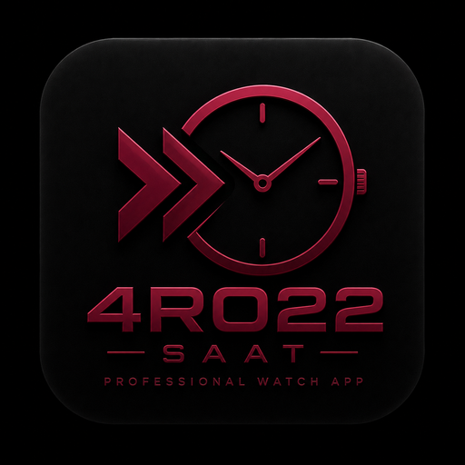
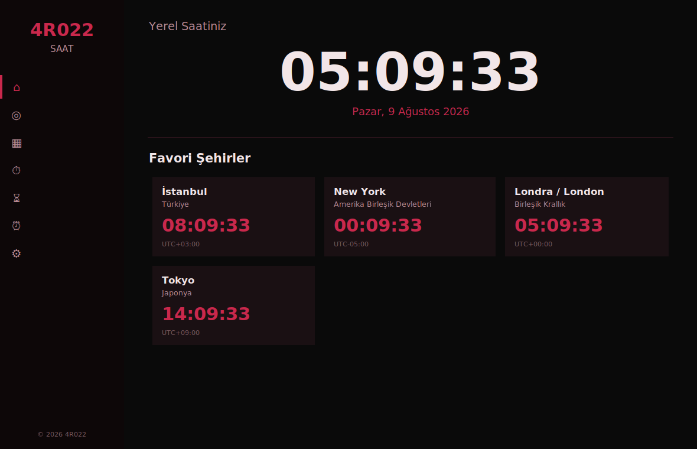
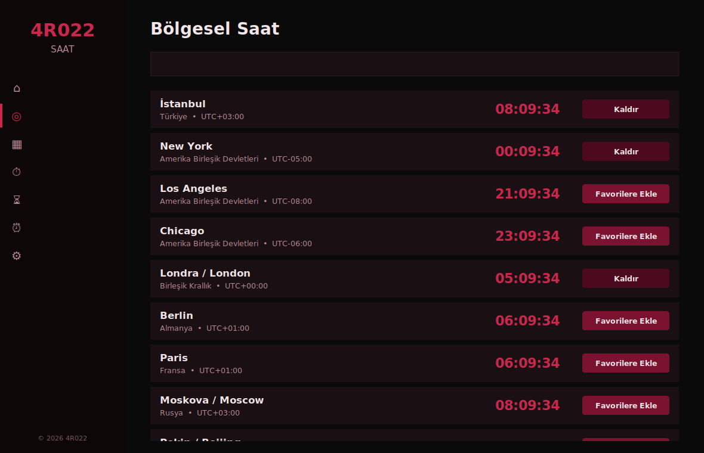
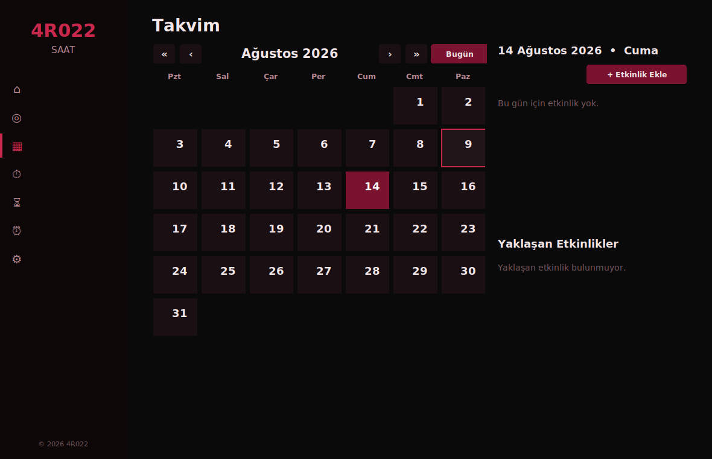
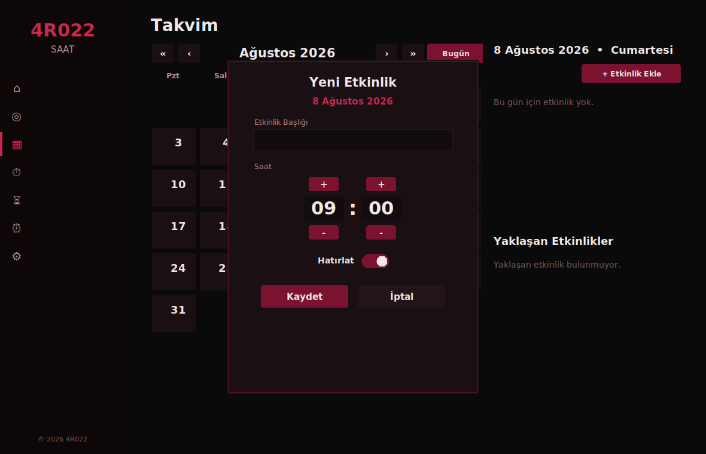
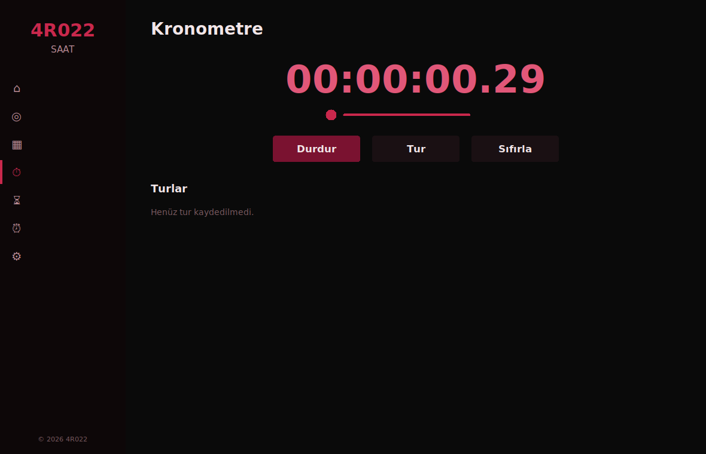
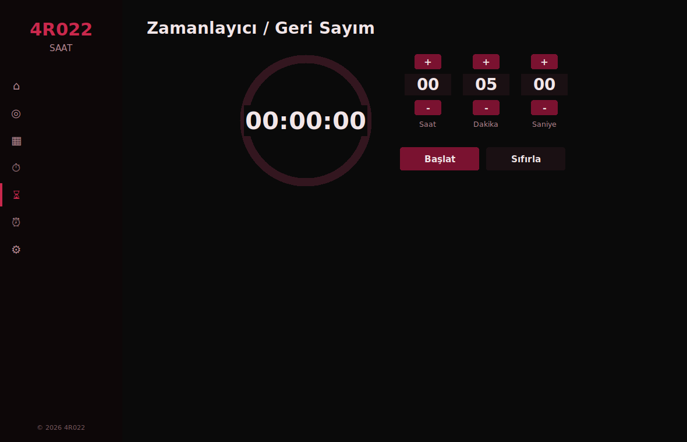
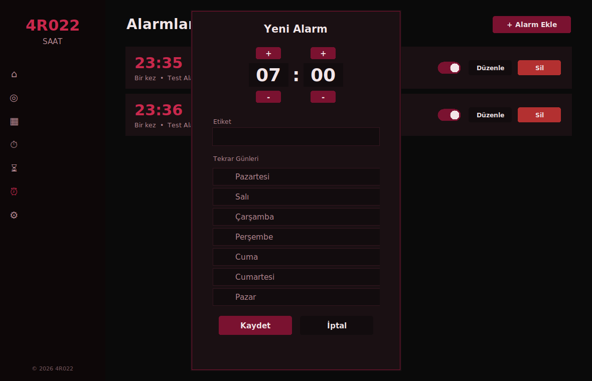
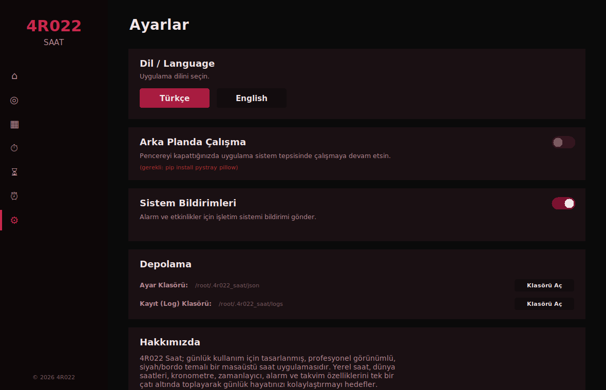

<div align="center">



# 4R022 SAAT

**Profesyonel, siyah/bordo temalı, çok özellikli masaüstü saat uygulaması**

Windows • Linux • macOS

[](CHANGELOG.md)
[](LICENSE)
[](https://www.python.org/)
[]()

[Özellikler](#-özellikler) •
[Ekran Görüntüleri](#-ekran-görüntüleri) •
[Kurulum](#-kurulum) •
[Kullanım](#-kullanım-kılavuzu) •
[Derleme](#-windows-exe-derleme) •
[SSS](#-sık-sorulan-sorular) •
[Lisans](#-lisans)

</div>

---

## 📖 Hakkında

**4R022 SAAT**, 4R022 markasının ikinci projesi olarak geliştirilmiş,
günlük hayatta gerçekten kullanılabilecek, profesyonel görünümlü bir
masaüstü saat uygulamasıdır. Tek bir Python dosyası üzerine inşa
edilmiş olup harici bir kütüphane gerekmeden (yalnızca standart
kütüphane ile) çalışır; isteğe bağlı birkaç kütüphane ile de sistem
tepsisi ve masaüstü bildirimleri gibi ek yeteneklere kavuşur.

Yerel saat, dünya saatleri, kronometre, zamanlayıcı, alarm sistemi ve
tam özellikli bir takvimi tek bir çatı altında toplar.

> 🇬🇧 **English speakers:** The app has full built-in English support —
> switch languages anytime from **Settings → Language**. This README
> is written in Turkish as it is the project's primary language, but
> the application UI itself is fully bilingual (TR/EN).

---

## ✨ Özellikler

### 🏠 Ana Sayfa
- Büyük, canlı güncellenen yerel saat ve tarih gösterimi
- Favori şehirlerin kart görünümünde anlık saatleri

### 🌍 Bölgesel Saat
- 50'den fazla ülke ve şehir
- Anlık arama (Türkçe karakter duyarsız arama desteği)
- Tek tıkla favorilere ekleme/kaldırma

### 📅 Takvim
- Yıllarca / aylarca sınırsız gezinme
- Geçmiş veya gelecekteki **herhangi bir güne** saatli etkinlik ekleme
- Etkinlik bazlı hatırlatma açma/kapama
- "Yaklaşan Etkinlikler" listesi
- Etkinliği olan günlerde görsel işaretleyici

### ⏱️ Kronometre
- Salise hassasiyetinde ölçüm
- Tur (lap) kaydı ve listesi
- Çalışırken belirgin nabız animasyonu

### ⏳ Zamanlayıcı / Geri Sayım
- Saat / dakika / saniye ayarlanabilir giriş
- Dairesel ilerleme göstergesi (progress ring)
- Süre dolunca sesli + görsel uyarı

### ⏰ Alarm Sistemi
- Sınırsız sayıda alarm
- Haftanın günlerine göre tekrar (tam gün adlarıyla, dikey seçim listesi)
- Etiketleme, erteleme (5 dakika snooze), aç/kapa anahtarı

### ⚙️ Ayarlar
- Türkçe / İngilizce anlık dil değişimi
- Arka planda çalışma (sistem tepsisi) aç/kapa
- İşletim sistemi bildirimleri aç/kapa
- Ayar ve log klasörlerini tek tıkla açma
- Marka / kurucu / sürüm / platform bilgisi

### 🖥️ Arka Planda Çalışma ve Bildirimler
- Pencere kapatıldığında sistem tepsisinde çalışmaya devam edebilme
- Tepsi simgesinin ipucunda **3 favori şehrin canlı saatleri**
- Alarm, etkinlik ve zamanlayıcı bildirimleri için yerel işletim
  sistemi bildirimleri (Windows / Linux / macOS)

### 🎨 Tasarım
- Siyah / bordo (maroon) profesyonel renk teması
- Özel çizilmiş, basınç ve geçiş animasyonlu butonlar
- Kenar çubuğunda yumuşak kayan seçim göstergesi
- Sayfa geçişlerinde kayma (slide) animasyonu
- Markalı splash (açılış) ekranı ve yumuşak kapanış animasyonu
- Görünür kaydırma çubuğu yok — temiz, modern fare tekerleği kaydırması

---

## 📸 Ekran Görüntüleri

<table>
<tr>
<td width="50%"><br><div align="center"><sub>Ana Sayfa — Yerel saat ve favori şehirler</sub></div></td>
<td width="50%"><br><div align="center"><sub>Bölgesel Saat — Arama ve favoriler</sub></div></td>
</tr>
<tr>
<td width="50%"><br><div align="center"><sub>Takvim — Sınırsız gezinme ve etkinlikler</sub></div></td>
<td width="50%"><br><div align="center"><sub>Yeni etkinlik ekleme penceresi</sub></div></td>
</tr>
<tr>
<td width="50%"><br><div align="center"><sub>Kronometre — Çalışırken nabız animasyonu</sub></div></td>
<td width="50%"><br><div align="center"><sub>Zamanlayıcı — Dairesel ilerleme göstergesi</sub></div></td>
</tr>
<tr>
<td width="50%"><br><div align="center"><sub>Alarm ekleme — Tam gün adlı seçim butonları</sub></div></td>
<td width="50%"><br><div align="center"><sub>Ayarlar — Dil, tepsi, bildirimler, depolama</sub></div></td>
</tr>
</table>

---

## 🚀 Kurulum

### Seçenek A — Hazır Windows `.exe` ile (önerilen, kurulum gerektirmez)

1. Bu deponun [Releases](../../releases) sayfasından en güncel
   `4R022_Saat.exe` dosyasını indirin.
2. İndirilen dosyaya çift tıklayın. Python kurulu olmasına gerek yoktur.

> `.exe` dosyaları bu depodaki GitHub Actions iş akışı tarafından her
> sürümde otomatik olarak, gerçek bir Windows ortamında derlenir (bkz.
> [`.github/workflows/build-windows.yml`](.github/workflows/build-windows.yml)).

### Seçenek B — Python kaynak kodundan çalıştırma (Windows / Linux / macOS)

**Gereksinimler:** Python 3.10 veya üzeri.

```bash
# Depoyu indirin
git clone https://github.com/<kullanici-adiniz>/4r022-saat.git
cd 4r022-saat

# (Opsiyonel ama önerilir) Sanal ortam oluşturun
python -m venv .venv
# Windows:
.venv\Scripts\activate
# Linux / macOS:
source .venv/bin/activate

# İsteğe bağlı özellikler (sistem tepsisi + bildirimler) için:
pip install -r requirements.txt

# Uygulamayı başlatın
python 4R022_Saat.py
```

> `requirements.txt` içindeki `pystray`, `pillow` ve `plyer`
> kütüphaneleri **isteğe bağlıdır**. Kurulu değilse uygulama sorunsuz
> çalışmaya devam eder; yalnızca "arka planda çalışma" ve "sistem
> bildirimleri" özellikleri Ayarlar sayfasında otomatik olarak devre
> dışı görünür.

---

## 📘 Kullanım Kılavuzu

### İlk Açılış
Uygulama açılırken kısa bir markalı splash ekranı gösterilir, ardından
ana pencere yumuşak bir geçişle açılır. Varsayılan dil Türkçe'dir;
**Ayarlar → Dil / Language** üzerinden İngilizce'ye anında geçilebilir.

### Gezinme
Sol kenar çubuğundaki simgelere tıklayarak sayfalar arasında geçiş
yapabilirsiniz: **Ana Sayfa, Bölgesel Saat, Takvim, Kronometre,
Zamanlayıcı, Alarm, Ayarlar.**

### Favori Şehir Ekleme
**Bölgesel Saat** sayfasında istediğiniz şehri arayın ve
**"Favorilere Ekle"** butonuna basın. Favori şehirler hem Ana
Sayfa'da hem de (etkinleştirdiyseniz) sistem tepsisi ipucunda
(ilk 3 tanesi) görünür.

### Takvime Etkinlik Ekleme
1. **Takvim** sayfasında `‹ ›` ile ay, `« »` ile yıl arasında gezinin.
2. Etkinlik eklemek istediğiniz güne tıklayın.
3. **"+ Etkinlik Ekle"** butonuna basıp başlık ve saat girin.
4. **"Hatırlat"** anahtarını açık bırakırsanız, o tarih/saat geldiğinde
   hem uygulama içi bir pencere hem de (etkinse) bir işletim sistemi
   bildirimi alırsınız.

### Alarm Kurma
**Alarm** sayfasında **"+ Alarm Ekle"** ile yeni bir alarm
oluşturabilir; saatini ayarlayıp, tekrar etmesini istediğiniz günleri
(tam adlarıyla listelenen) seçebilirsiniz. Gün seçilmezse alarm yalnızca
bir kez çalar ve otomatik olarak kapanır.

### Arka Planda Çalışma
**Ayarlar → Arka Planda Çalışma** anahtarını açtığınızda, pencereyi
kapat (X) tuşuna bastığınızda uygulama tamamen kapanmaz; sistem
tepsisinde simgesiyle çalışmaya devam eder. Tepsi simgesine
**sol tıklayarak** pencereyi tekrar açabilir, **sağ tıklayarak** menüden
**"Çıkış"** seçeneğiyle uygulamayı tamamen kapatabilirsiniz.

### Verileriniz Nerede Saklanıyor?
Tüm ayarlarınız, alarmlarınız ve etkinlikleriniz bilgisayarınızda
yerel olarak, aşağıdaki klasörde saklanır (Ayarlar sayfasından tek
tıkla açılabilir):

```
Windows:  C:\Users\<KullanıcıAdınız>\.4r022_saat\
Linux/Mac: ~/.4r022_saat/
    ├── json/config.json   → ayarlar, favoriler, alarmlar, etkinlikler
    └── logs/uygulama.log  → çalışma günlüğü (log)
```

---

## 🛠️ Windows `.exe` Derleme

Kendi bilgisayarınızda derlemek isterseniz üç yöntem vardır:

### 1) Otomatik — GitHub Actions (önerilen)
Bu depoyu fork'layıp `main` dalına push yaptığınızda veya `v` ile
başlayan bir etiket (ör. `v2.0V`) oluşturduğunuzda, GitHub kendi
Windows sunucusunda otomatik olarak derleme yapar ve `.exe` dosyasını
**Actions → Artifacts** bölümünde (etiketli sürümlerde ayrıca
**Releases** bölümünde) sizin için hazırlar. Yerel bir Windows
makineye ihtiyacınız yoktur.

### 2) Yerel — Windows'ta `build.bat`
```
build.bat
```
dosyasına çift tıklamanız yeterlidir. Gerekli paketleri otomatik
kurar ve `dist\4R022_Saat.exe` dosyasını oluşturur.

### 3) Yerel — Linux / macOS'ta `build.sh`
```bash
chmod +x build.sh
./build.sh
```

Her iki yöntem de aynı [`4R022_Saat.spec`](4R022_Saat.spec) dosyasını
kullanır; bu dosya uygulamanın simgesini (`assets/icon.ico`) ve tüm
kaynak dosyalarını otomatik olarak paketler.

---

## 📁 Proje Yapısı

```
4r022-saat/
├── 4R022_Saat.py              # Ana uygulama (tek dosya)
├── 4R022_Saat.spec            # PyInstaller derleme tanımı
├── requirements.txt           # İsteğe bağlı bağımlılıklar
├── build.bat / build.sh       # Yerel derleme betikleri
├── LICENSE                    # Özel mülkiyet lisansı (TR/EN)
├── CHANGELOG.md                # Sürüm geçmişi (v1.0 → v2.0V)
├── README.md                  # Bu dosya
├── .github/workflows/
│   └── build-windows.yml      # Otomatik Windows .exe derleme (CI)
└── assets/
    ├── icon.ico / icon.png    # Uygulama logosu
    └── screenshots/           # README ekran görüntüleri
```

---

## ❓ Sık Sorulan Sorular

**Uygulama internet bağlantısı gerektiriyor mu?**
Hayır. Tüm saat hesaplamaları sabit UTC ofsetleriyle yerel olarak
yapılır, herhangi bir sunucuya bağlanılmaz.

**Dünya saatleri yaz saati uygulamasını (DST) dikkate alıyor mu?**
Hayır, sadelik ve harici bağımlılık gerektirmemek adına sabit UTC
ofsetleri kullanılır. Bu, birkaç ülkede yaz saati dönemlerinde
saatin 1 saat farklı görünmesine neden olabilir.

**"Arka Planda Çalışma" seçeneği neden gri (devre dışı) görünüyor?**
Bu özellik `pystray` ve `pillow` kütüphanelerini gerektirir. Kaynak
koddan çalıştırıyorsanız `pip install -r requirements.txt` komutunu
çalıştırmanız yeterlidir. Hazır `.exe` sürümünde bu kütüphaneler
zaten pakete dahildir.

**Bildirimlerde uygulama adı yerine "Python" görünüyor.**
Bu, yalnızca `python 4R022_Saat.py` komutuyla, paketlenmemiş halde
çalıştırıldığında bazı işletim sistemlerinde ortaya çıkabilecek bir
görünüm sorunudur — bildirim başlığı yine de her zaman "4R022 SAAT"
ile başlar. Sorunu tamamen ortadan kaldırmak için hazır `.exe`
sürümünü kullanmanız yeterlidir.

---

## 🙏 Teşekkürler

4R022 SAAT, markamızın **ikinci projesidir**. Bu projeye gösterdiğiniz
yoğun ilgi ve 4R022'yi tercih ettiğiniz için içtenlikle teşekkür
ederiz. Her geri bildirim bizim için değerlidir ve uygulamayı sizin
için geliştirmeye devam edeceğiz. Bu teşekkür notunu uygulamanın
**Ayarlar → Hakkımızda** bölümünde de bulabilirsiniz.

---

## 📄 Lisans

Bu proje **özel mülkiyet (proprietary)** bir lisans ile korunmaktadır.
Yazılımın kaynak kodu veya derlenmiş hali **tersine mühendisliğe tabi
tutulamaz, kopyalanamaz, değiştirilemez veya izinsiz olarak
başka bir yerde paylaşılamaz/dağıtılamaz.** Ayrıntılar için
[LICENSE](LICENSE) dosyasına bakınız.

**Marka:** 4R022
**Kurucu:** Kaan Kross
**Telif Hakkı:** © 2026 Kaan Kross / 4R022 — Tüm hakları saklıdır.

<div align="center">
<sub>4R022 SAAT ile zamanınızı profesyonelce yönetin. ⏱️</sub>
</div>

<br>

---

<br>

<div align="center">

# 🇬🇧 English Version

</div>

<div align="center">


# 4R022 SAAT

**A professional, black/maroon themed, feature-rich desktop clock application**

Windows • Linux • macOS

[](CHANGELOG.md)
[](LICENSE)
[](https://www.python.org/)
[]()

[Features](#-features) •
[Screenshots](#-screenshots) •
[Installation](#-installation) •
[Usage](#-usage-guide) •
[Building](#-building-the-windows-exe) •
[FAQ](#-faq) •
[License](#-license-1)

</div>

---

## 📖 About

**4R022 SAAT** ("SAAT" means "clock/watch" in Turkish) is the second
project from the 4R022 brand — a professional-looking desktop clock
app built for genuine everyday use. It's built as a single Python
file that runs with **no external dependencies** (standard library
only); a few optional libraries unlock extra capabilities such as
system tray support and desktop notifications.

It brings together local time, world clocks, a stopwatch, a timer, a
full alarm system, and a full-featured calendar — all under one roof.

> The application UI itself is **fully bilingual** — switch between
> Turkish and English anytime from **Settings → Language**. This
> section is an English translation of the README above for
> international readers browsing this repository.

---

## ✨ Features

### 🏠 Home
- Large, live-updating local time and date display
- Favorite cities shown as live-updating cards

### 🌍 World Clock
- 50+ countries and cities
- Instant search (accent-insensitive, works with plain ASCII too)
- One-click add/remove favorites

### 📅 Calendar
- Unlimited navigation across years and months
- Add timed events to **any** day, past or future
- Per-event reminder toggle
- "Upcoming Events" list
- Visual marker on days that have events

### ⏱️ Stopwatch
- Centisecond precision
- Lap recording and list
- Clearly visible pulse animation while running

### ⏳ Timer / Countdown
- Adjustable hours / minutes / seconds input
- Circular progress ring
- Sound + visual alert when time is up

### ⏰ Alarm System
- Unlimited alarms
- Repeat by day of week (full day names, vertical selection list)
- Labels, snooze (5 minutes), enable/disable toggle

### ⚙️ Settings
- Instant Turkish / English language switch
- Run in background (system tray) on/off
- OS notifications on/off
- One-click access to config and log folders
- Brand / founder / version / platform info

### 🖥️ Background Running & Notifications
- Keep running in the system tray when the window is closed
- Tray icon tooltip shows **3 favorite cities' live times**
- Native OS notifications (Windows / Linux / macOS) for alarms,
  events, and timer completion

### 🎨 Design
- Professional black/maroon color theme
- Custom-drawn buttons with hover and press animations
- Smoothly sliding selection indicator in the sidebar
- Slide transition animation between pages
- Branded splash screen (fade-in/fade-out) and a smooth closing animation
- No visible scrollbars — clean, modern mouse-wheel scrolling only

---

## 📸 Screenshots

See the [screenshots section](#-ekran-görüntüleri) above — the same
images apply to both language sections.

---

## 🚀 Installation

### Option A — Prebuilt Windows `.exe` (recommended, no setup required)

1. Download the latest `4R022_Saat.exe` from this repo's
   [Releases](../../releases) page.
2. Double-click it. Python is not required.

> The `.exe` is built automatically, on a genuine Windows environment,
> by this repository's GitHub Actions workflow — see
> [`.github/workflows/build-windows.yml`](.github/workflows/build-windows.yml).

### Option B — Run from Python source (Windows / Linux / macOS)

**Requirements:** Python 3.10 or newer.

```bash
# Clone the repository
git clone https://github.com/<your-username>/4r022-saat.git
cd 4r022-saat

# (Optional but recommended) Create a virtual environment
python -m venv .venv
# Windows:
.venv\Scripts\activate
# Linux / macOS:
source .venv/bin/activate

# Install optional features (system tray + notifications):
pip install -r requirements.txt

# Run the application
python 4R022_Saat.py
```

> `pystray`, `pillow`, and `plyer` in `requirements.txt` are
> **optional**. Without them the app runs perfectly fine — only the
> "run in background" and "OS notifications" settings will appear
> automatically disabled.

---

## 📘 Usage Guide

### First Launch
A short branded splash screen appears on startup, followed by a
smooth fade-in of the main window. The default language is Turkish;
switch to English anytime via **Settings → Language**.

### Navigation
Use the sidebar icons to switch between pages: **Home, World Clock,
Calendar, Stopwatch, Timer, Alarm, Settings.**

### Adding a Favorite City
On the **World Clock** page, search for a city and click **"Add to
Favorites."** Favorite cities appear both on the Home page and (if
enabled) in the system tray tooltip (first 3).

### Adding a Calendar Event
1. On the **Calendar** page, use `‹ ›` to change months and `« »` to
   change years.
2. Click the day you want to add an event to.
3. Click **"+ Add Event,"** enter a title and time.
4. Leave **"Remind Me"** on to get both an in-app popup and (if
   enabled) an OS notification when the date/time arrives.

### Setting an Alarm
On the **Alarm** page, click **"+ Add Alarm"** to create a new alarm.
Set its time and pick the days you want it to repeat on (listed with
full day names). If no day is selected, the alarm fires once and
disables itself automatically.

### Running in the Background
Turn on **Settings → Run in Background**, and closing the window (X)
will no longer quit the app — it keeps running in the system tray.
**Left-click** the tray icon to reopen the window; **right-click** for
a menu with an **"Exit"** option to fully quit.

### Where Is Your Data Stored?
All your settings, alarms, and events are stored locally on your
computer (accessible with one click from the Settings page):

```
Windows:   C:\Users\<YourUsername>\.4r022_saat\
Linux/Mac: ~/.4r022_saat/
    ├── json/config.json   → settings, favorites, alarms, events
    └── logs/uygulama.log  → application log
```

---

## 🛠️ Building the Windows `.exe`

There are three ways to build it yourself:

### 1) Automatic — GitHub Actions (recommended)
Fork this repo and push to `main`, or create a tag starting with `v`
(e.g. `v2.0V`), and GitHub will automatically build the `.exe` on its
own Windows runner, making it available under **Actions → Artifacts**
(and under **Releases** for tagged versions). No local Windows
machine required.

### 2) Local — Windows `build.bat`
Just double-click:
```
build.bat
```
It installs the required packages automatically and produces
`dist\4R022_Saat.exe`.

### 3) Local — Linux / macOS `build.sh`
```bash
chmod +x build.sh
./build.sh
```

Both methods use the same [`4R022_Saat.spec`](4R022_Saat.spec) file,
which automatically bundles the app icon (`assets/icon.ico`) and all
resource files.

---

## 📁 Project Structure

```
4r022-saat/
├── 4R022_Saat.py              # Main application (single file)
├── 4R022_Saat.spec            # PyInstaller build definition
├── requirements.txt           # Optional dependencies
├── build.bat / build.sh       # Local build scripts
├── LICENSE                    # Proprietary license (TR/EN)
├── CHANGELOG.md                # Version history (v1.0 → v2.0V)
├── README.md                  # This file
├── .github/workflows/
│   └── build-windows.yml      # Automatic Windows .exe build (CI)
└── assets/
    ├── icon.ico / icon.png    # Application logo
    └── screenshots/           # README screenshots
```

---

## ❓ FAQ

**Does the app require an internet connection?**
No. All time calculations are done locally using fixed UTC offsets;
no server connection is made.

**Does the World Clock account for Daylight Saving Time (DST)?**
No — for simplicity and to avoid external dependencies, fixed UTC
offsets are used. This may cause a 1-hour discrepancy in some
countries during DST periods.

**Why does "Run in Background" appear greyed out?**
This feature requires the `pystray` and `pillow` libraries. If
running from source, simply run `pip install -r requirements.txt`.
The prebuilt `.exe` already includes these libraries.

**Notifications show "Python" instead of the app name.**
This can happen on some systems only when running unpackaged via
`python 4R022_Saat.py` — the notification's title text will still
always start with "4R022 SAAT" regardless. Using the prebuilt `.exe`
avoids this cosmetic issue entirely.

---

## 🙏 Thank You

4R022 SAAT is our brand's **second project**. We sincerely thank you
for your strong interest and for choosing 4R022. Every piece of
feedback matters to us, and we will keep improving this app for you.
You can also find this note inside the app under
**Settings → About Us**.

---

## 📄 License

This project is protected by a **proprietary license**. The
software's source code or compiled form **may not be reverse
engineered, copied, modified, or redistributed/shared elsewhere
without authorization.** See the [LICENSE](LICENSE) file for details.

**Brand:** 4R022
**Founder:** Kaan Kross
**Copyright:** © 2026 Kaan Kross / 4R022 — All rights reserved.

<div align="center">
<sub>Manage your time professionally with 4R022 SAAT. ⏱️</sub>
</div>
